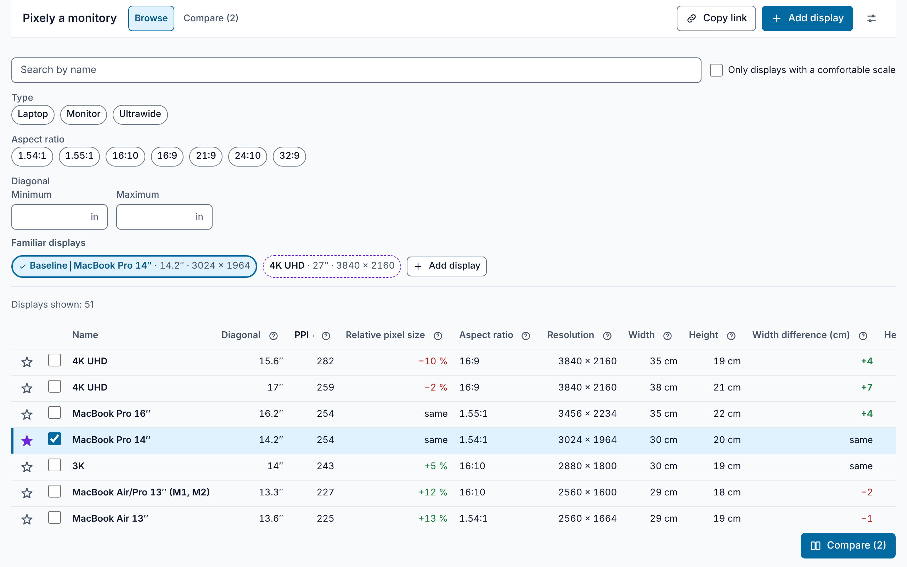
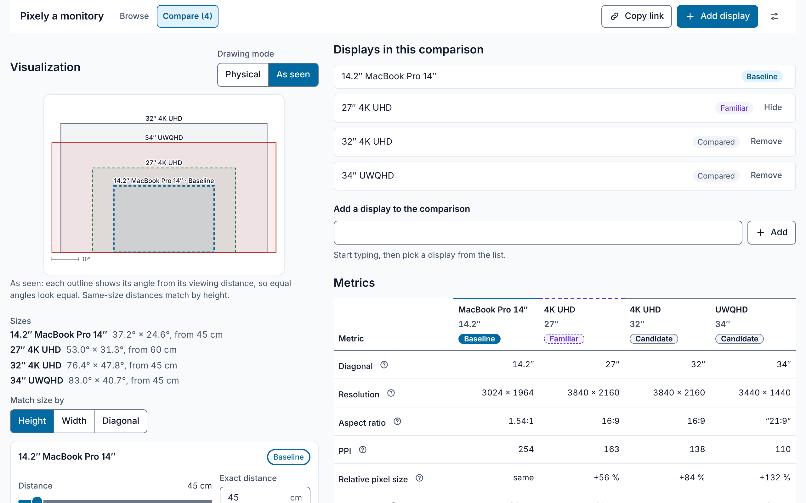
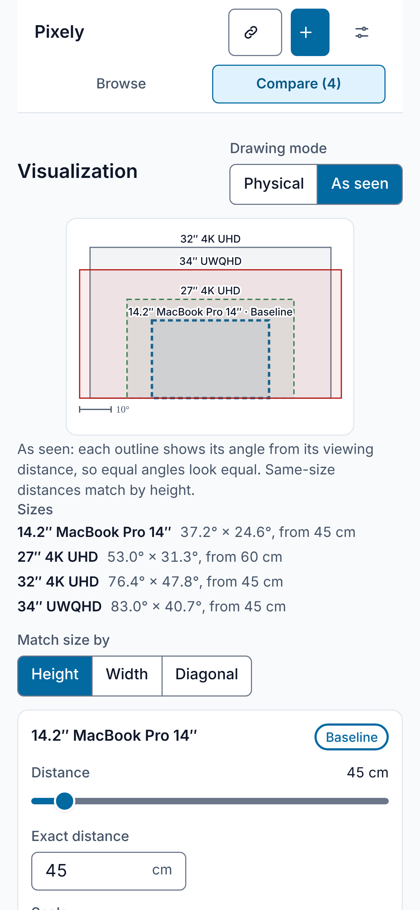

# Pixely a monitory

[](https://github.com/benabraham/monitor-sizes/actions/workflows/ci.yml)
[](https://github.com/benabraham/monitor-sizes/actions/workflows/deploy.yml)

Pixely a monitory answers one question: how will this display look and feel compared with the
displays I already know, from which distance, and at which OS scale does it feel right? You mark
the displays you know and the distance you sit from each. Then you browse candidates, compare
them side by side, and see them drawn to scale or as they appear from your chair. It is an
offline, installable web app with no accounts and no tracking.

**Live app:** <https://benabraham.github.io/monitor-sizes/>

## Screenshots







## Features

Each feature names the PRD requirements it delivers (see [`docs/PRD.md`](docs/PRD.md)).

- **Familiar displays and a baseline.** Mark the displays you know, each with your usual distance
  and OS scale. One of them is the baseline, and every relative figure is measured against it.
  Tap another familiar display to make it the baseline. (F2, F3)
- **Browse with a comfort filter.** A sortable table on desktop and cards on phones, with search,
  filters for type, aspect ratio and diagonal, and a toggle that keeps only the displays with at
  least one comfortable scale. (F4, F5, F8, F9)
- **Scaling recommendations.** The scale that suits each display best, with Windows, macOS and
  Linux/Wayland presets and custom scales such as 133 %. The comfort window can use effective PPI,
  or logical pixels per degree when you set a viewing distance. (F6, F7, F21, F23)
- **Compare, with the visualization always on screen.** Every compared display is drawn together,
  either to scale (Physical) or at its angle from its own viewing distance (As seen). (F10, F11, F12)
- **Viewing distances and equivalent distances.** Set how far you sit from each display. Three
  one-tap matches (same size, same sharpness, same text size) set a candidate's distance from the
  baseline. (F13, F15)
- **Angular metrics.** Horizontal and vertical field of view in degrees, pixels per degree, and
  logical pixels per degree at the chosen scale. (F14)
- **Metric and imperial units.** Centimetres and dm², or inches and in². Values are stored in
  inches, so switching units loses nothing. (F16)
- **Czech and English.** The interface follows the browser language and can be switched at any
  time. Numbers follow the language, so Czech uses a decimal comma. (F16)
- **Add your own displays.** Add a display from onboarding, the familiar picker, Browse or Compare,
  and edit or delete it later. Built-in displays can be hidden but not edited. (F17)
- **Inline help.** Every metric header has a help popover that explains the metric. (F20)
- **Share links.** "Copy link" puts the whole view in the URL: familiar displays, compared displays,
  distances, scales, units, filters and your custom displays. The recipient can keep the comparison
  or go back to their own displays. (F19)
- **"Like my screen".** Fills in the resolution and scale from the browser, so you only type the
  diagonal. (F22)
- **JSON import and export.** Your custom displays and familiar set, saved as a file. (F18)
- **Offline and installable.** Works offline after the first visit. Installs as an app in Chromium
  browsers and on iOS and Android home screens. (Offline and Install requirements)

## Quick start for developers

You need Node 24 (see [`.nvmrc`](.nvmrc); Node 22.12 is the minimum) and corepack, which provides
the pnpm version pinned in `package.json`.

```sh
corepack enable
pnpm install
pnpm dev                                # dev server, app under /monitor-sizes/
pnpm test                               # unit and component tests (Vitest)
pnpm exec playwright install chromium   # once, before the end-to-end tests
pnpm e2e                                # Playwright tests against a production build
pnpm check                              # format check, coverage, build and bundle size
```

`pnpm check` runs the same steps as CI, except the end-to-end tests. Setup and scripts are
described in [`docs/CONTRIBUTING.md`](docs/CONTRIBUTING.md), and deployment in
[`docs/DEPLOYMENT.md`](docs/DEPLOYMENT.md).

## Tech stack

| Concern        | Choice                                                                               |
| -------------- | ------------------------------------------------------------------------------------ |
| Build          | Vite 8, with the base path `/monitor-sizes/`                                         |
| UI             | Preact 11 with `@preact/signals`. JavaScript with JSDoc types, no TypeScript         |
| PWA            | `vite-plugin-pwa` with Workbox. A new version applies on the next launch             |
| Storage        | IndexedDB, through `idb-keyval`                                                      |
| Styling        | Plain modern CSS with custom properties, in light and dark themes                    |
| Tests          | Vitest 5 with jsdom and Testing Library, fake-indexeddb, Playwright 1.63 in Chromium |
| Quality        | Prettier 3. A JavaScript budget of under 50 kB gzipped, checked in CI                |
| Hosting and CI | GitHub Pages, deployed by GitHub Actions                                             |

## Project structure

```
src/
  lib/                  pure logic without a framework
    calc/               the maths: geometry, aspect, scaling, angular
    format.js           number, percent, length and angle formatting
    units.js            inch and centimetre conversion
    scales.js           OS scale presets and custom scale parsing
    url-state.js        view state in the URL
    storage.js          IndexedDB persistence, which never throws
  state/                signals, computed rows, actions, URL and storage sync
  components/           one folder per component (browse, compare-visual, onboarding, ...)
  i18n/locales/         en and cs, one file per namespace
  data/seed.json        built-in displays, inputs only
  styles/               design tokens and global CSS
scripts/                bundle-size check, icon generator, one-off sheet import
tests/e2e/              Playwright specs
data/sheet-snapshot/    frozen copy of the original spreadsheet, used as a test fixture
docs/                   product, architecture, calculation and user documentation
```

## Documentation

| Document                                        | For                                              |
| ----------------------------------------------- | ------------------------------------------------ |
| [User guide](docs/USER-GUIDE.md)                | People using the app                             |
| [Průvodce pro uživatele](docs/USER-GUIDE.cs.md) | Uživatele v češtině                              |
| [Calculations](docs/CALCULATIONS.md)            | Every formula, rounding rule and worked example  |
| [PRD](docs/PRD.md)                              | Product requirements (F1 to F23) and decisions   |
| [Architecture](docs/ARCHITECTURE.md)            | Module contract, data model and code conventions |
| [Contributing](docs/CONTRIBUTING.md)            | Setup, scripts and adding a built-in display     |
| [Deployment](docs/DEPLOYMENT.md)                | CI, the GitHub Pages deploy and the base path    |
| [Design](docs/DESIGN.md)                        | Design tokens, UI primitives and accessibility   |
| [I18N](docs/I18N.md)                            | Translations, formatting and copy rules          |
| [State](docs/STATE.md)                          | View state, share-link format and persistence    |

The sheet snapshot that the acceptance tests use is described in
[`data/sheet-snapshot/README.md`](data/sheet-snapshot/README.md).

## Data source

The built-in displays are a JSON seed, [`src/data/seed.json`](src/data/seed.json). It holds 51
displays, from 13.3″ laptops to a 55.5″ 10080 × 4320 panel: 14 laptops, 22 monitors and 15
ultrawides. The seed holds inputs only (name, diagonal, width, height and tag). Every other figure
is calculated when the app runs.

The Google Sheet that the data came from is retired. Its frozen copy is used only by the tests. New
built-in displays arrive as pull requests that edit the seed. See
[Adding a built-in display](docs/CONTRIBUTING.md#adding-a-built-in-display).

## Privacy

There are no accounts, no analytics, no cookies, and no network calls beyond loading the app from
its static host. Your familiar displays, custom displays and preferences are kept in your browser's
IndexedDB storage.

A share link carries its state after the `#`. Browsers do not send that part to the server, but
anyone who has the link can read the comparison, including the names of any custom displays in it.

## Browser support

The app uses only features from Baseline 2024. It works in current Chromium-based browsers, Safari
and Firefox. Installing it as an app works in Chromium-based browsers and on iOS and Android home
screens. Firefox on desktop gets a cached website rather than an installed app.

## Licence

MIT. See [`LICENSE`](LICENSE).

Contributions are welcome. See [`docs/CONTRIBUTING.md`](docs/CONTRIBUTING.md) for the workflow and
the code conventions.
